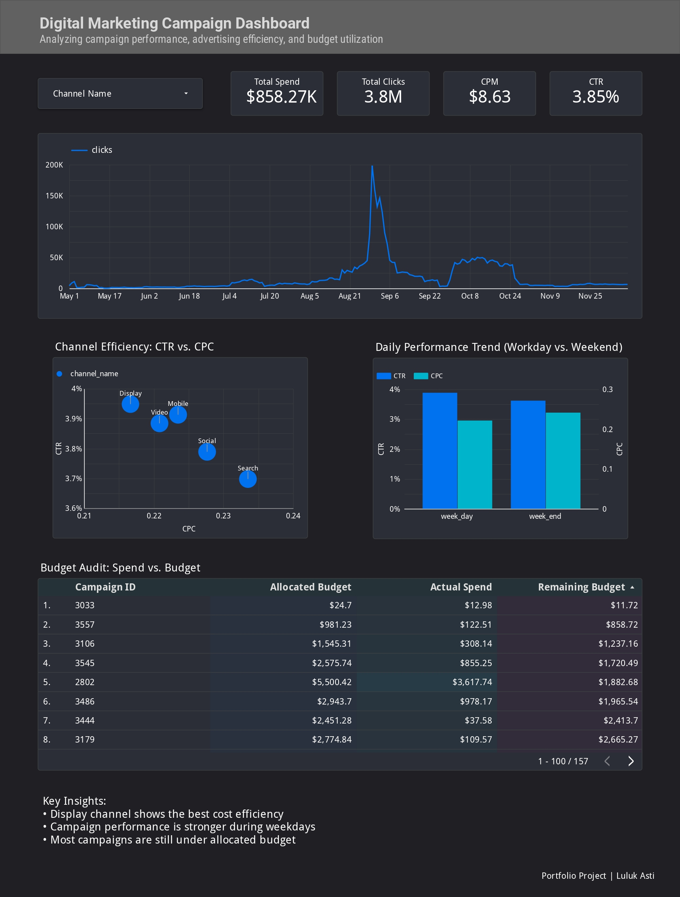

# Analisis Performa Kampanye Digital Marketing dan Efisiensi Anggaran

## 📌 Gambaran Proyek

Proyek ini bertujuan untuk mengevaluasi performa kampanye digital marketing dan menganalisis efisiensi penggunaan anggaran iklan pada berbagai kanal pemasaran.

Dengan memanfaatkan data kampanye iklan, proyek ini berfokus pada analisis interaksi audiens, perbandingan efisiensi antar-channel, tren performa kampanye, serta penggunaan anggaran untuk mendukung pengambilan keputusan bisnis berbasis data.

Proses analisis meliputi pengolahan dan pembersihan data menggunakan Python dan Pandas di Google Colab, kemudian visualisasi hasil analisis menggunakan Google Looker Studio.

## 🎯 Tujuan Analisis

1. Mengevaluasi efektivitas kampanye digital marketing berdasarkan impresi, klik, dan rasio klik.
2. Membandingkan efisiensi biaya iklan antar-kanal pemasaran.
3. Menganalisis perbedaan performa kampanye antara hari kerja dan akhir pekan.
4. Memantau penggunaan anggaran melalui perbandingan anggaran yang dialokasikan, pengeluaran aktual, dan sisa anggaran.
5. Menyediakan informasi yang dapat mendukung optimasi kampanye dan alokasi anggaran iklan.

## ❓ Pertanyaan Bisnis

### 1. Apakah kampanye marketing berjalan efektif?

- Bagaimana tren impresi dan klik iklan dari waktu ke waktu?
- Kanal pemasaran mana yang memiliki Click-Through Rate (CTR) lebih tinggi?
- Apakah performa kampanye berbeda antara hari kerja dan akhir pekan?

### 2. Apakah anggaran iklan sudah digunakan secara efisien?

- Berapa total biaya yang dikeluarkan untuk kampanye iklan?
- Kanal pemasaran mana yang memiliki Cost Per Click (CPC) lebih rendah?
- Bagaimana perbandingan anggaran yang dialokasikan dengan pengeluaran aktual?
- Kampanye mana yang memiliki sisa anggaran paling besar?

## 🛠️ Tools dan Teknologi

- **Python** — Pengolahan dan persiapan data.
- **Pandas** — Manipulasi dan pembersihan data.
- **Google Colab** — Lingkungan untuk menjalankan kode Python.
- **Google Looker Studio** — Visualisasi data dan pembuatan dashboard interaktif.

## 📊 Dashboard

Dashboard interaktif dibuat menggunakan Google Looker Studio untuk menyajikan indikator performa kampanye, efisiensi biaya antar-kanal pemasaran, tren klik, serta penggunaan anggaran.

### Pratinjau Dashboard



🔗 **[Lihat Dashboard Interaktif di Google Looker Studio](https://datastudio.google.com/reporting/e8f28b3c-1ea1-4a8f-9975-ddd778578032)**

## 📈 Metrik yang Dianalisis

| Metrik | Hasil | Penjelasan |
|---|---:|---|
| Total Spend | $858.27K | Total biaya iklan yang dikeluarkan. |
| Total Clicks | 3.8M | Total klik yang dihasilkan kampanye. |
| CTR | 3.85% | Persentase impresi yang menghasilkan klik. |
| CPM | $8.63 | Biaya per 1.000 impresi. |
| CPC | Berdasarkan channel | Rata-rata biaya untuk memperoleh satu klik. |
| Allocated Budget | Per kampanye | Anggaran yang dialokasikan. |
| Actual Spend | Per kampanye | Pengeluaran aktual kampanye. |
| Remaining Budget | Per kampanye | Sisa anggaran setelah dikurangi pengeluaran aktual. |

## 💡 Temuan Utama

Berdasarkan hasil visualisasi pada dashboard, diperoleh beberapa temuan:

1. **Efisiensi Kanal Pemasaran**

   Channel Display menunjukkan efisiensi biaya terbaik dibandingkan channel lainnya. Display memiliki CTR tertinggi sekaligus CPC terendah, sehingga mampu menghasilkan interaksi iklan dengan biaya per klik yang relatif lebih rendah.

2. **Perbandingan Performa Hari Kerja dan Akhir Pekan**

   Kampanye menunjukkan performa yang lebih baik pada hari kerja (weekday), dengan CTR sekitar 3,9%, dibandingkan akhir pekan (weekend) sekitar 3,6%. Selain itu, CPC pada hari kerja juga lebih rendah, yaitu sekitar $0,22 dibandingkan $0,24 pada akhir pekan.

3. **Tren Performa Klik**

   Tren klik menunjukkan adanya lonjakan aktivitas yang signifikan pada akhir Agustus hingga awal September. Setelah periode tersebut, aktivitas klik mengalami penurunan dan menunjukkan fluktuasi pada periode berikutnya.

4. **Penggunaan Anggaran Kampanye**

   Sebagian besar kampanye belum menggunakan seluruh anggaran yang dialokasikan. Hal ini terlihat dari nilai Remaining Budget yang masih positif pada mayoritas kampanye dalam dashboard, sehingga terdapat ruang untuk mengevaluasi kembali alokasi dan pemanfaatan anggaran iklan.

Temuan tersebut dapat menjadi bahan evaluasi dalam menentukan kanal pemasaran yang lebih efisien, mengoptimalkan waktu penayangan kampanye, serta meningkatkan efektivitas penggunaan anggaran iklan.

## ⚠️ Batasan Analisis

Analisis ini berfokus pada performa interaksi iklan, efisiensi biaya, dan penggunaan anggaran.

Dataset yang digunakan belum menyediakan metrik konversi dan pendapatan penjualan. Oleh karena itu, analisis ini belum dapat memastikan efektivitas kampanye dalam menghasilkan penjualan, Return on Advertising Spend (ROAS), atau profitabilitas secara keseluruhan.

## 📁 Struktur Proyek

```text
digital-marketing-campaign-analysis/
│
├── README.md
│
├── dashboard/
│   ├── README.md
│   └── dashboard_preview.jpg
│
├── data/
│   ├── README.md
│   ├── Marketing_campaign.csv
│   └── clean_marketing_data.csv
│
└── notebooks/
    ├── README.md
    └── marketing_data_cleaning.ipynb
```

## 👩‍💻 Tentang Penulis

**Luluk Asti**

Proyek ini merupakan bagian dari portofolio analisis data yang berfokus pada pengolahan data, visualisasi, dan penerapan analisis untuk mendukung pengambilan keputusan bisnis.
