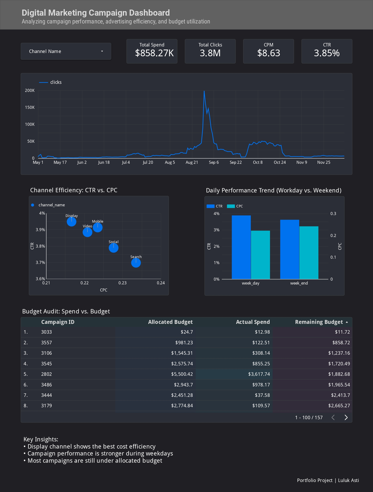

# Analisis Performa Kampanye Digital Marketing dan Efisiensi Anggaran

## 📌 Gambaran Proyek

Proyek ini bertujuan untuk mengevaluasi performa kampanye digital marketing dan menganalisis efisiensi penggunaan anggaran iklan pada berbagai kanal pemasaran.

Dengan memanfaatkan data kampanye iklan, proyek ini berfokus pada analisis interaksi audiens, perbandingan efisiensi antar-channel, tren performa kampanye, serta penggunaan anggaran untuk mendukung pengambilan keputusan bisnis berbasis data.

Proses analisis meliputi pengolahan dan pembersihan data menggunakan Python dan Pandas di Google Colab, kemudian visualisasi hasil analisis menggunakan Google Looker Studio.

## 🎯 Tujuan Analisis

1. Mengevaluasi performa kampanye digital marketing dari sisi engagement, yaitu impresi, klik, dan rasio klik (CTR).
2. Membandingkan efisiensi biaya iklan antar-kanal pemasaran (CTR dan CPC).
3. Menganalisis perbedaan performa kampanye antara hari kerja dan akhir pekan.
4. Mengevaluasi penggunaan anggaran dengan membandingkan anggaran yang dialokasikan, pengeluaran aktual, dan sisa anggaran per kampanye.
5. Menyusun temuan awal yang dapat menjadi dasar untuk mengoptimalkan kampanye dan alokasi anggaran.

## ❓ Pertanyaan Bisnis

**1. Apakah kampanye berjalan efektif dari sisi engagement?**
- Bagaimana tren klik iklan dari waktu ke waktu?
- Kanal pemasaran mana yang memiliki Click-Through Rate (CTR) lebih tinggi?
- Apakah performa kampanye berbeda antara hari kerja dan akhir pekan?

**2. Apakah anggaran iklan sudah digunakan secara efisien?**
- Berapa total biaya yang dikeluarkan untuk kampanye iklan?
- Kanal pemasaran mana yang memiliki Cost Per Click (CPC) lebih rendah?
- Bagaimana perbandingan anggaran yang dialokasikan dengan pengeluaran aktual?
- Kampanye mana yang memiliki sisa anggaran paling besar?

> Catatan: "efektif" di sini berarti efektif dalam menarik interaksi (klik dan CTR), bukan efektif menghasilkan penjualan. Lihat bagian [Batasan Analisis](#️-batasan-analisis).

## 🗺️ Pemetaan Pertanyaan ke Dashboard

| Pertanyaan bisnis | Visual di dashboard |
|---|---|
| Efektivitas (engagement) | KPI cards, grafik tren clicks, grafik weekday vs weekend |
| Perbandingan channel | Scatter plot CTR vs CPC |
| Efisiensi anggaran | Tabel Budget Audit (allocated, actual, remaining) |

## 🧹 Langkah Pembersihan Data

1. Memeriksa jumlah baris dan kolom dataset.
2. Memeriksa nama kolom dan tipe data setiap kolom.
3. Menyesuaikan tipe data sesuai kebutuhan analisis (misalnya kolom tanggal ke format datetime).
4. Memeriksa nilai kosong (missing value) pada setiap kolom.
5. Memilih 11 kolom yang relevan dari 35 kolom dataset asli (termasuk `week_day_cat` untuk perbandingan hari kerja dan akhir pekan).
6. Menyimpan data hasil pembersihan ke `clean_marketing_data.csv`.

Detail kode ada di `notebooks/marketing_data_cleaning.ipynb`.

## 🛠️ Tools dan Teknologi

- **Python** — Pengolahan dan persiapan data.
- **Pandas** — Manipulasi dan pembersihan data.
- **Google Colab** — Lingkungan untuk menjalankan kode Python.
- **Google Looker Studio** — Visualisasi data dan pembuatan dashboard interaktif.

## 📦 Sumber Data

Dataset publik dari Kaggle: [Marketing Campaign Dataset](https://www.kaggle.com/datasets/rahulchavan99/marketing-campaign-dataset) oleh Rahul Chavan. Bukan data perusahaan sungguhan.

- **Periode data:** 1 Mei 2022 – 10 Desember 2022
- **Ukuran:** 35 kolom pada dataset asli; 11 kolom dipilih untuk analisis ini.
- **Lisensi:** Tidak dicantumkan oleh pembuat dataset (tertulis "Unknown" di halaman Kaggle). Dataset digunakan hanya untuk tujuan belajar dan portofolio, dan seluruh hak atas data tetap milik pembuat aslinya.
- **Pengelompokan hari kerja/akhir pekan:** menggunakan kolom `week_day_cat` yang sudah ada di dataset asli.

## 📊 Dashboard

Dashboard interaktif dibuat menggunakan Google Looker Studio untuk menyajikan indikator performa kampanye, efisiensi biaya antar-kanal pemasaran, tren klik, serta penggunaan anggaran.

### Pratinjau Dashboard



🔗 [Lihat Dashboard Interaktif di Google Looker Studio](https://datastudio.google.com/reporting/e8f28b3c-1ea1-4a8f-9975-ddd778578032)

## 📈 Metrik yang Dianalisis

| Metrik | Hasil | Penjelasan |
|---|---|---|
| Total Spend | $858.27K | Total biaya iklan yang dikeluarkan. |
| Total Clicks | 3.8M | Total klik yang dihasilkan kampanye. |
| CTR | 3.85% | Persentase impresi yang menghasilkan klik. |
| CPM | $8.63 | Biaya per 1.000 impresi. |
| CPC | Berdasarkan channel | Rata-rata biaya untuk memperoleh satu klik. |
| Allocated Budget | Per kampanye | Anggaran yang dialokasikan. |
| Actual Spend | Per kampanye | Pengeluaran aktual kampanye. |
| Remaining Budget | Per kampanye | Sisa anggaran setelah dikurangi pengeluaran aktual. |

## 💡 Temuan Utama

Berdasarkan hasil visualisasi pada dashboard:

1. **Efisiensi kanal pemasaran.** Display memiliki CTR tertinggi (≈3.95%) sekaligus CPC terendah (≈$0.22) di antara lima channel. Selisih antar channel relatif kecil (CTR sekitar 3.70–3.95%; CPC sekitar $0.217–$0.234), sehingga perbedaan ini belum dipastikan signifikan.

2. **Hari kerja vs akhir pekan.** Kampanye cenderung berperforma lebih baik pada hari kerja: CTR sekitar 3.9% dibanding 3.6% pada akhir pekan, dengan CPC sekitar $0.22 dibanding $0.24. Selisih ini juga belum dipastikan signifikan.

3. **Tren klik.** Terdapat lonjakan klik pada akhir Agustus hingga awal September, kemudian menurun dan berfluktuasi. Penyebab lonjakan belum diselidiki dalam analisis ini.

4. **Penggunaan anggaran.** Dari 157 kampanye, tidak ada yang melebihi anggaran yang dialokasikan. Sisa anggaran terkecil adalah $11.72 (Campaign ID 3033). Sisa terbesar ada pada Campaign ID 2766: dari anggaran $4,047,340, hanya $42,098.07 (sekitar 1%) yang terpakai, sehingga tersisa $4,005,241.93. Delapan kampanye dengan sisa anggaran terbesar semuanya baru memakai sebagian kecil dari anggarannya.

## ✅ Rekomendasi Awal

1. **Tinjau kampanye dengan anggaran besar yang hampir tidak terpakai** (misalnya Campaign ID 2766): apakah anggarannya terlalu besar, kampanyenya belum berjalan, atau ada kendala lain.
2. **Pertimbangkan Display sebagai channel prioritas untuk diuji lebih lanjut**, karena CTR tertinggi dan CPC terendah. Selisihnya kecil, jadi sebaiknya dicoba dengan porsi anggaran terbatas lebih dulu, lalu hasilnya dibandingkan.
3. **Perhatikan waktu penayangan.** Performa hari kerja cenderung lebih baik, sehingga jadwal tayang bisa diuji lebih lanjut dengan data yang lebih banyak.
4. **Lengkapi data dengan konversi dan pendapatan** agar efektivitas terhadap penjualan dan ROAS bisa dihitung.

## ⚠️ Batasan Analisis

- Dataset tidak memiliki data konversi dan pendapatan penjualan. Karena itu analisis ini belum bisa memastikan efektivitas kampanye dalam menghasilkan penjualan, Return on Advertising Spend (ROAS), maupun profitabilitas.
- Perbandingan antar-channel dan antara hari kerja dengan akhir pekan dilakukan secara deskriptif dari dashboard, belum melalui uji statistik.
- Dataset bersifat publik dan bukan data perusahaan sungguhan, sehingga temuan bersifat latihan analisis.

## 📁 Struktur Proyek

```
digital-marketing-campaign-analysis/
│
├── README.md
│
├── dashboard/
│   ├── README.md
│   └── dashboard_preview.jpg
│
├── data/
│   ├── README.md
│   └── clean_marketing_data.csv
│
└── notebooks/
    ├── README.md
    └── marketing_data_cleaning.ipynb
```

## 👩‍💻 Tentang Penulis

Luluk Asti Qomariah, lulusan S1 Teknik Informatika UMSIDA 2026 yang berfokus pada analisis data.

- LinkedIn: https://www.linkedin.com/in/luluk-asti-q/
- GitHub: https://github.com/Lulukia0704

Proyek ini merupakan bagian dari portofolio analisis data yang berfokus pada pengolahan data, visualisasi, dan penerapan analisis untuk mendukung pengambilan keputusan bisnis.
