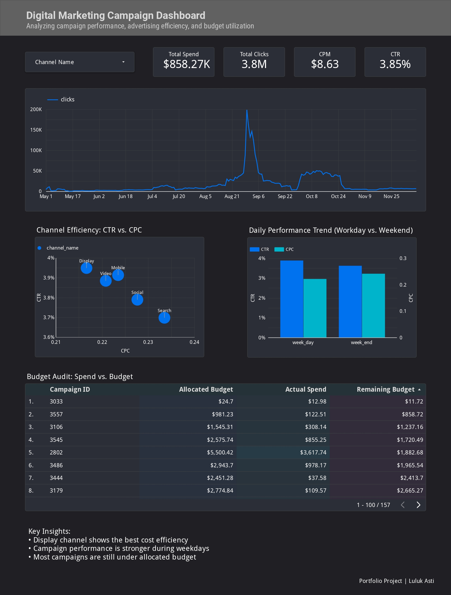

# Analisis Performa Kampanye Digital Marketing dan Efisiensi Anggaran

## 📌 Gambaran Proyek

Proyek ini bertujuan untuk mengevaluasi performa kampanye digital marketing dan menganalisis efisiensi penggunaan anggaran iklan pada berbagai kanal pemasaran.

Dengan memanfaatkan data kampanye iklan, proyek ini berfokus pada analisis interaksi audiens, perbandingan efisiensi antar-channel, tren performa kampanye, serta penggunaan anggaran untuk mendukung pengambilan keputusan bisnis berbasis data.

Proses analisis meliputi pengolahan dan pembersihan data menggunakan Python dan Pandas di Google Colab, kemudian visualisasi hasil analisis menggunakan Google Looker Studio.

## 🎯 Tujuan Analisis

1. Mengevaluasi efektivitas kampanye digital marketing berdasarkan impresi, klik, dan rasio klik.
2. Membandingkan efisiensi biaya iklan antar-kanal pemasaran.
3. Menganalisis perbedaan performa kampanye antara hari kerja dan akhir pekan.
4. Memantau penggunaan anggaran melalui perbandingan anggaran yang dialokasikan, pengeluaran aktual, dan sisa anggaran.
5. Menyediakan informasi yang dapat mendukung optimasi kampanye dan alokasi anggaran iklan.

## ❓ Pertanyaan Bisnis

### 1. Apakah kampanye marketing berjalan efektif?

- Bagaimana tren impresi dan klik iklan dari waktu ke waktu?
- Kanal pemasaran mana yang memiliki Click-Through Rate (CTR) lebih tinggi?
- Apakah performa kampanye berbeda antara hari kerja dan akhir pekan?

### 2. Apakah anggaran iklan sudah digunakan secara efisien?

- Berapa total biaya yang dikeluarkan untuk kampanye iklan?
- Kanal pemasaran mana yang memiliki Cost Per Click (CPC) lebih rendah?
- Bagaimana perbandingan anggaran yang dialokasikan dengan pengeluaran aktual?
- Kampanye mana yang memiliki sisa anggaran paling besar?

## 🧹 Langkah Pembersihan Data
1. Memilih 11 kolom yang relevan dari 32 kolom dataset asli.
2. Mengonversi tipe data (misalnya kolom tanggal). [ISI: konfirmasi]
3. [ISI: langkah lain, misalnya memeriksa nilai kosong, duplikat, atau membuat kolom weekday/weekend]
4. Menyimpan hasil ke `clean_marketing_data.csv`.

Detail kode ada di `notebooks/marketing_data_cleaning.ipynb`.

## 🛠️ Tools dan Teknologi

- **Python** — Pengolahan dan persiapan data.
- **Pandas** — Manipulasi dan pembersihan data.
- **Google Colab** — Lingkungan untuk menjalankan kode Python.
- **Google Looker Studio** — Visualisasi data dan pembuatan dashboard interaktif.

## 📦 Sumber Data
Dataset publik dari Kaggle: *Marketing Campaign Dataset* (Rahul Chavan). Bukan data perusahaan sungguhan.
- **Periode data:** [ISI: tahun, 1 Mei – akhir November]
- **Ukuran:** 32 kolom pada dataset asli; 11 kolom dipilih untuk analisis ini.
- **Lisensi:** [ISI: lisensi di halaman Kaggle]

## 📊 Dashboard

Dashboard interaktif dibuat menggunakan Google Looker Studio untuk menyajikan indikator performa kampanye, efisiensi biaya antar-kanal pemasaran, tren klik, serta penggunaan anggaran.

### Pratinjau Dashboard



🔗 **[Lihat Dashboard Interaktif di Google Looker Studio](https://datastudio.google.com/reporting/e8f28b3c-1ea1-4a8f-9975-ddd778578032)**

## 📈 Metrik yang Dianalisis

| Metrik | Hasil | Penjelasan |
|---|---:|---|
| Total Spend | $858.27K | Total biaya iklan yang dikeluarkan. |
| Total Clicks | 3.8M | Total klik yang dihasilkan kampanye. |
| CTR | 3.85% | Persentase impresi yang menghasilkan klik. |
| CPM | $8.63 | Biaya per 1.000 impresi. |
| CPC | Berdasarkan channel | Rata-rata biaya untuk memperoleh satu klik. |
| Allocated Budget | Per kampanye | Anggaran yang dialokasikan. |
| Actual Spend | Per kampanye | Pengeluaran aktual kampanye. |
| Remaining Budget | Per kampanye | Sisa anggaran setelah dikurangi pengeluaran aktual. |

## 💡 Temuan Utama
Berdasarkan hasil visualisasi pada dashboard:

**Efisiensi Kanal Pemasaran**
Display memiliki CTR tertinggi (≈3,95%) sekaligus CPC terendah (≈$0,22) di antara lima channel. Namun selisih antar channel relatif kecil (CTR sekitar 3,70–3,95%; CPC sekitar $0,217–$0,234), dan perbedaannya belum diuji secara statistik.

**Perbandingan Hari Kerja dan Akhir Pekan**
Kampanye cenderung berperforma lebih baik pada hari kerja: CTR sekitar 3,9% dibanding sekitar 3,6% pada akhir pekan, dengan CPC sekitar $0,22 dibanding $0,24. Perbedaan ini juga belum diuji secara statistik.

**Tren Performa Klik**
Terdapat lonjakan klik yang signifikan pada akhir Agustus hingga awal September, kemudian menurun dan berfluktuasi pada periode berikutnya.

**Penggunaan Anggaran**
Dari 157 kampanye, tidak ada yang melebihi anggaran yang dialokasikan; sisa anggaran terkecil adalah $11,72 (Campaign ID 3033). Sisa terbesar ada pada kampanye [ISI: Campaign ID] sebesar $4.005.241,93, atau baru sekitar 1% dari anggaran $4.047.340 yang terpakai.

## ⚠️ Batasan Analisis

Analisis ini berfokus pada performa interaksi iklan, efisiensi biaya, dan penggunaan anggaran.

Dataset yang digunakan belum menyediakan metrik konversi dan pendapatan penjualan. Oleh karena itu, analisis ini belum dapat memastikan efektivitas kampanye dalam menghasilkan penjualan, Return on Advertising Spend (ROAS), atau profitabilitas secara keseluruhan.

## 📁 Struktur Proyek

```text
digital-marketing-campaign-analysis/
│
├── README.md
│
├── dashboard/
│   ├── README.md
│   └── dashboard_preview.jpg
│
├── data/
│   ├── README.md
│   ├── Marketing_campaign.csv
│   └── clean_marketing_data.csv
│
└── notebooks/
    ├── README.md
    └── marketing_data_cleaning.ipynb
```

## 👩‍💻 Tentang Penulis
**Luluk Asti Qomariah**, lulusan S1 Informatika UMSIDA 2026 yang berfokus pada analisis data.
- LinkedIn: https://www.linkedin.com/in/luluk-asti-q/
- GitHub: https://github.com/Lulukia0704

Proyek ini merupakan bagian dari portofolio analisis data yang berfokus pada pengolahan data, visualisasi, dan penerapan analisis untuk mendukung pengambilan keputusan bisnis.
